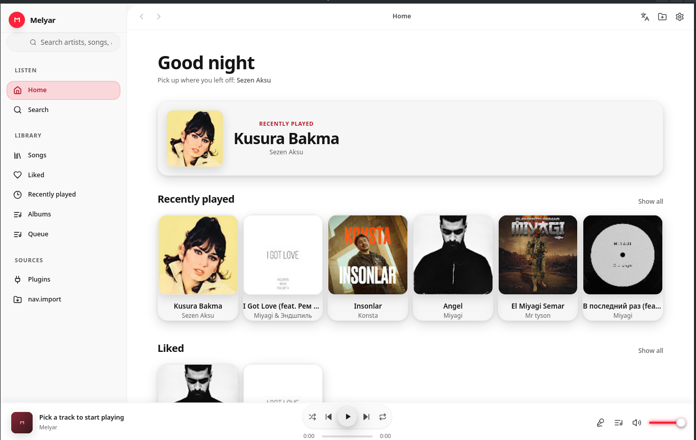
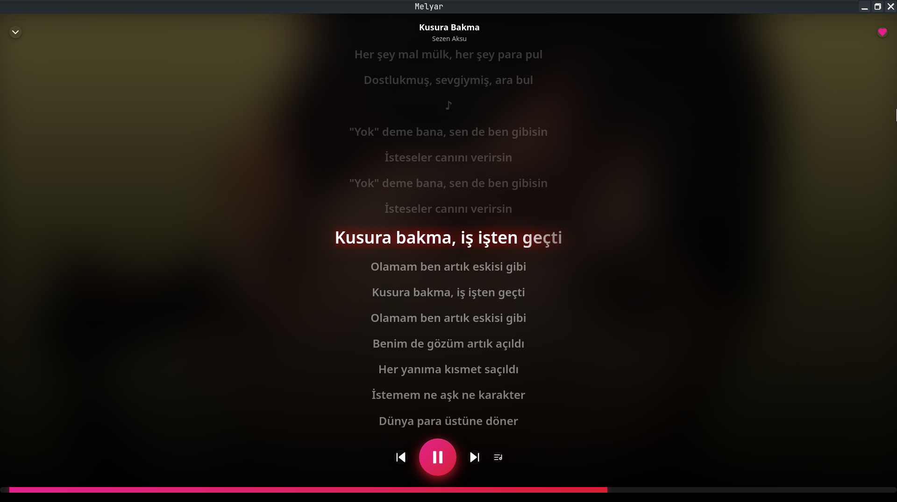
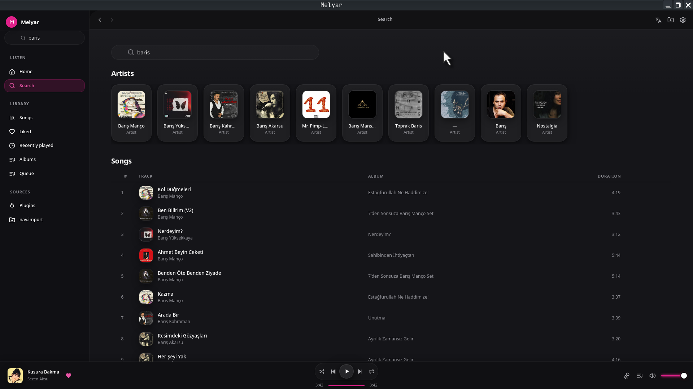

<div align="center">

# Melyar

**Ultra-lightweight native desktop client for YouTube Music**

[](https://github.com/MAKHMUDuz/melyar/actions/workflows/ci.yml)
[](https://github.com/MAKHMUDuz/melyar/releases/latest)
[](LICENSE-APACHE)
[](https://github.com/MAKHMUDuz/melyar/discussions)

</picture>

<h1 align="center">Hi 👋, I'm MAKHMUDJON MURODOV</h1>

</div>

<picture>
  <source media="(prefers-reduced-motion: no-preference)" srcset="https://capsule-render.vercel.app/api?type=waving&color=gradient&height=210&section=header&text=MAKHMUDJON%20MURODOV&fontSize=44&fontAlignY=32&desc=Desktop%20%E2%80%A2%20Web%20%E2%80%A2%20GPU%20tooling&descSize=18&descAlignY=55&animation=fadeIn" />
  
</picture>

<h2 align="center">Melyar - YouTube Music Desktop Client</h2>

<p align="center">
  <a href="https://raw.githubusercontent.com/MAKHMUDuz/melyar/main/screnshot/Screenshot_20261104_022059.png">
    
  </a>
</picture>

<picture>
  <source media="(prefers-reduced-motion: no-preference)" srcset="https://capsule-render.vercel.app/api?type=waving&color=gradient&height=210&section=header&text=MAKHMUDJON%20MURODOV&fontSize=44&fontAlignY=32&desc=Desktop%20%E2%80%A2%20Web%20%E2%80%A2%20GPU%20tooling&descSize=18&descAlignY=55&animation=fadeIn" />
  
</picture>

<h2 align="center">Melyar - YouTube Music Desktop Client</h2>

<p align="center">
  <a href="https://raw.githubusercontent.com/MAKHMUDuz/melyar/main/screnshot/Screenshot_20261104_022907.png">
    
  </a>
</picture>

<picture>
  <source media="(prefers-reduced-motion: no-preference)" srcset="https://capsule-render.vercel.app/api?type=waving&color=gradient&height=210&section=header&text=MAKHMUDJON%20MURODOV&fontSize=44&fontAlignY=32&desc=Desktop%20%E2%80%A2%20Web%20%E2%80%A2%20GPU%20tooling&descSize=18&descAlignY=55&animation=fadeIn" />
  
</picture>

<h2 align="center">Melyar - YouTube Music Desktop Client</h2>

<p align="center">
  <a href="https://raw.githubusercontent.com/MAKHMUDuz/melyar/main/screnshot/Screenshot_20261104_022939.png">
    
  </a>
</picture>

<p align="center">
  <a href="https://raw.githubusercontent.com/MAKHMUDuz/melyar/main/screnshot/melyar.webm" target="_blank">
    
  </a>
</p>

<div align="center">

# Melyar

**Ultra-lightweight native desktop client for YouTube Music**

[](https://github.com/MAKHMUDuz/melyar/actions/workflows/ci.yml)
[](https://github.com/MAKHMUDuz/melyar/releases/latest)
[](LICENSE-APACHE)
[](https://github.com/MAKHMUDuz/melyar/discussions)

</div>

Melyar is a Linux-first, local-first desktop music client for YouTube Music. It combines a fast Rust core, a native Qt/C++ shell, and a polished React + TypeScript interface to deliver a clean, responsive listening experience without the overhead of heavier desktop frameworks.


## Why Melyar

Melyar is built for people who want a music player that feels native on Linux:

- Small runtime footprint
- Fast startup and responsive controls
- Deep desktop integration with MPRIS and Waybar
- No account requirement to launch the app
- Local-first behavior with personal library data stored on disk

## Highlights

- Search, browse, and play YouTube Music content
- Playback with `libmpv` and gapless streaming behavior
- Queue management, shuffle, repeat, volume, and seek controls
- Synced LRC lyrics with plain-text fallback
- Favorites, history, albums, artists, and library views
- Library import from a Spotify export, JSON or CSV — **Import & Transfer 2.0 (demo/active stage)**
- Ten band graphic equaliser (31 Hz - 16 kHz)
- Liquid Glass-inspired interface with light/dark theming
- Thirteen interface languages, switched at runtime
- Native Linux media integration via MPRIS and Unix socket IPC

## Screenshots



## Architecture

```text
React + TypeScript UI
        │
        │ QWebChannel
        ▼
Qt / C++ bridge
        │
        ▼
Rust core ── playback, library, provider logic, IPC
        │
        ▼
mpv audio playback
```

The C++ ↔ Rust boundary is connected via the `cxx` bridge, while the UI communicates with the core through Qt/WebChannel.

## Install

Arch and Debian/Ubuntu packages are attached to the
[latest release](https://github.com/MAKHMUDuz/melyar/releases/latest). No
build toolchain is needed:

**Debian / Ubuntu** (Ubuntu 24.04 or newer):

```bash
sudo apt install ./melyar_*_amd64.deb
```

**Arch** (dependencies come from the official repos):

```bash
sudo pacman -U melyar-*.pkg.tar.zst
```